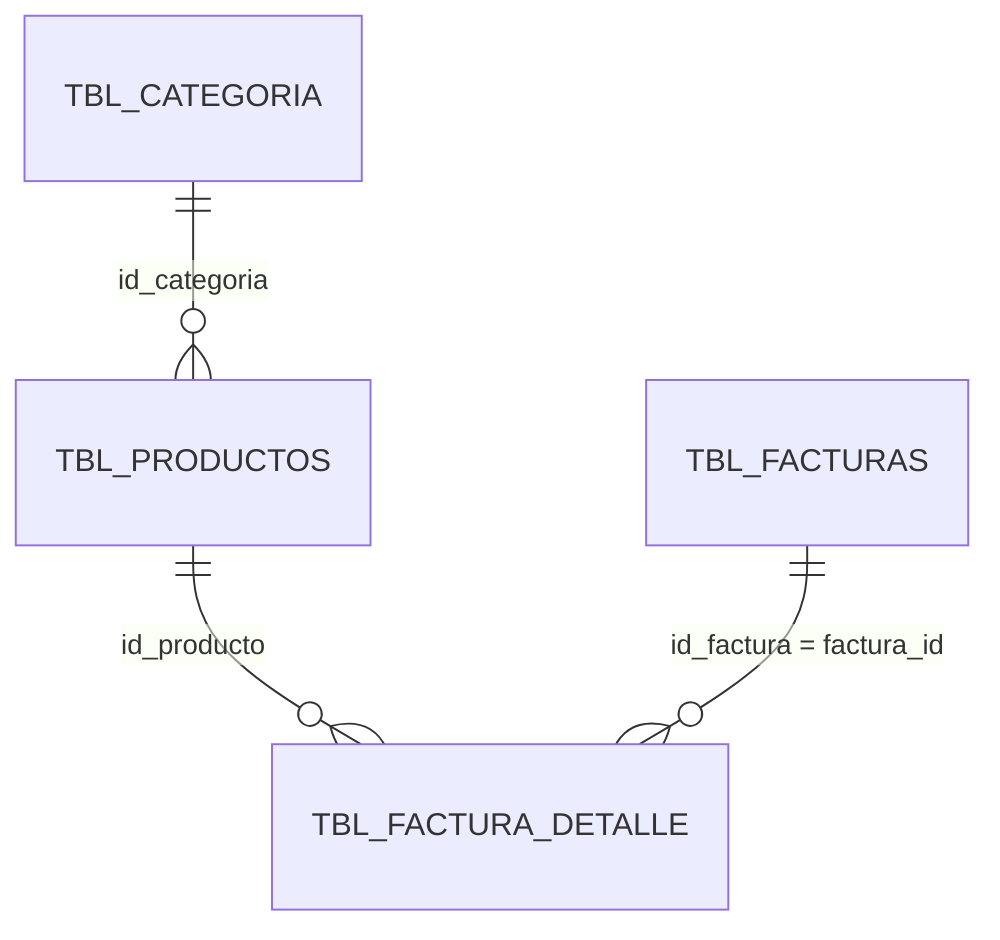

# DOCUMENTO TÉCNICO DE DIAGNÓSTICO

## Fase II — Entrega del Segundo Avance del Componente Inteligente

**Componente:** Analítica predictiva de demanda e inventario  
**Módulo de integración:** Productos  
**Versión del modelo identificada en el código:** `ridge-lag4-v1`

## Alcance y criterio de elaboración

Este diagnóstico describe el comportamiento que se encuentra implementado en la vista de Productos, el controlador PHP, el proxy y el microservicio de analítica predictiva. La guía de entrenamiento local se utiliza para explicar su operación, pero no se presenta como si añadiera funcionalidades que el código no tenga.

El componente no es un sistema experto con una base de conocimiento relacional propia. Combina un modelo de regresión Ridge autoregresivo para pronosticar demanda semanal con reglas deterministas para calcular reposición y proponer asociaciones de productos. Sus parámetros entrenados se almacenan en un archivo JSON, y las valoraciones de recomendaciones se guardan en JSONL. Por ello, donde la pauta solicita tablas o métricas todavía no implementadas, se indica expresamente en lugar de inventar resultados.

## 1. Diseño detallado del algoritmo o modelo inteligente

### 1.1 Técnica implementada

El pronóstico de demanda utiliza una **regresión lineal Ridge autoregresiva de cuatro rezagos semanales**. No se observa en el código una red neuronal, árbol de decisión, motor de reglas experto ni dependencia de Scikit-Learn o PySwip. El ajuste se realiza con operaciones matriciales de NumPy.

Para cada producto habilitado (y para cada categoría agregando las ventas de sus productos) se construye una serie de 24 semanas completas. Las semanas sin ventas se representan mediante cero. Se requiere que al menos seis de las 24 semanas tengan ventas; si no se cumple, no se ajusta ese modelo.

Para una serie semanal \(y_1,\ldots,y_{24}\), cada fila de entrenamiento usa las cuatro semanas previas para estimar la semana siguiente:

\[
x_t = [1,\ y_{t-1},\ y_{t-2},\ y_{t-3},\ y_{t-4}], \quad t=5,\ldots,24
\]

Por tanto, el ajuste genera hasta 20 filas por modelo. Los coeficientes se calculan mediante:

\[
\hat{\beta} = (X^\mathsf{T}X + \Lambda)^{-1}X^\mathsf{T}y
\]

La matriz de penalización aplicada por el código es:

\[
\Lambda = \operatorname{diag}(0,\ 0.25,\ 0.25,\ 0.25,\ 0.25)
\]

El término independiente no se penaliza. El error guardado es el error cuadrático medio residual expresado como raíz:

\[
\operatorname{RMSE} =
\sqrt{\frac{1}{n}\sum_{t=1}^{n}(y_t - x_t\hat{\beta})^2}
\]

El artefacto registra la versión, la fecha de entrenamiento, los coeficientes, el RMSE, la cantidad de filas de entrenamiento y las semanas históricas usadas.

### 1.2 Generación de pronósticos y métricas

La predicción se calcula recursivamente por semana: se toman las últimas cuatro semanas, se multiplica el vector de rezagos por los coeficientes y el resultado se limita a cero como mínimo. Las predicciones semanales se reparten uniformemente entre sus días. Para el intervalo mostrado se usa el RMSE residual:

\[
\text{límite inferior} = \max(0,\hat{y} - 1.96\cdot\operatorname{RMSE}),\quad
\text{límite superior} = \hat{y} + 1.96\cdot\operatorname{RMSE}
\]

La banda se presenta como una referencia visual del error del modelo; el código no demuestra que sea un intervalo de confianza estadístico calibrado.

Con el pronóstico disponible, el servicio calcula:

- **Venta proyectada:** suma de la demanda diaria estimada durante el horizonte.
- **Días estimados hasta agotamiento:** primer día en el que la demanda acumulada alcanza el stock actual. Si el stock es cero y la proyección es positiva, informa cero. Si faltan datos de inventario o no se alcanza el stock dentro del horizonte, queda sin valor.
- **Punto de reorden:** stock mínimo configurado, solo para la consulta de un producto.
- **Compra sugerida:** \(\max(0,\lceil\text{demanda proyectada}+\text{stock mínimo}-\text{stock actual}\rceil)\). No descuenta órdenes abiertas, tal como advierte la interfaz.
- **Rotación proyectada:** demanda del horizonte dividida entre el inventario promedio estimado \((stock actual + stock final)/2\), cuando el denominador es positivo.

Las frecuencias de presentación disponibles son diaria, semanal y mensual. Los horizontes admitidos son 15, 30, 60 y 90 días. La selección por categoría puede producir proyección e histórico agregados; las métricas de inventario que requieren un producto individual no se calculan para ese alcance.

### 1.3 Reglas auxiliares de recomendación

Además de la regresión, el dashboard aplica estas reglas:

1. **Reposición:** para productos con stock, mínimo y modelo individual, proyecta hasta 90 días como máximo. Recomienda una acción si el stock está en o debajo del mínimo, o si la demanda prevista supera el stock. La cantidad sugerida usa la misma fórmula de demanda + mínimo − stock.
2. **Combos observados:** cuenta los productos distintos que aparecen en cada factura. Solo considera pares que aparecen juntos en al menos dos facturas. Calcula la confianza como el mayor cociente entre coocurrencia y facturas de cada producto; el soporte es la proporción de facturas analizadas que contienen el par.
3. **Combos estratégicos:** identifica productos con stock sobre el mínimo, baja rotación mensual y poca venta reciente, y los empareja con productos populares. Un producto popular requiere al menos cinco registros de venta, rotación mensual de al menos 1 y una tendencia que no sea inferior a -20 %. Se limita a los diez productos congelados de mayor excedente y hasta tres propuestas por producto. El descuento y la composición sugeridos son heurísticas del código, no optimización de precios ni un resultado de experimento.
4. **Orden de salida:** combina reposición, combos estratégicos y combos observados; ordena por prioridad ajustada y limita la respuesta a 20 recomendaciones.

La prioridad de recomendaciones puede ajustarse por la valoración promedio del tipo. Con valoraciones disponibles, el factor aplicado es \(0.7 + 0.3\cdot(\text{promedio}/5)\); sin valoraciones, es 1.

### 1.4 Pseudocódigo del proceso

```text
ENTRENAMIENTO(productos, ventas):
    filtrar ventas de los últimos 365 días
    conservar productos habilitados
    para cada producto:
        agregar cantidades por día y convertir a 24 semanas completas
        rellenar semanas sin ventas con cero
        si existen 24 semanas y al menos 6 semanas con ventas:
            crear filas con intercepto y cuatro rezagos
            ajustar coeficientes Ridge con penalización [0, .25, .25, .25, .25]
            guardar coeficientes, RMSE y metadatos por producto
    para cada categoría:
        agregar las series diarias de sus productos habilitados
        ajustar con el mismo procedimiento si cumple el mínimo
    si ningún modelo es entrenable:
        devolver historial insuficiente y conservar el artefacto anterior
    de lo contrario:
        escribir artefacto JSON temporal y reemplazar el archivo del modelo

ANÁLISIS(solicitud):
    validar que se seleccione exactamente un producto o una categoría
    resolver los productos incluidos y agregar ventas históricas
    si no hay productos o ventas:
        devolver estado sin_datos o sin_ventas
    cargar modelo del producto/categoría si existe
    si existe:
        pronosticar semanas recursivamente hasta el horizonte solicitado
        derivar métricas de demanda e inventario
    generar recomendaciones de reposición y combos a partir de ventas/stock
    ajustar prioridad con feedback disponible, ordenar y limitar a 20
    devolver histórico, predicción, calidad, métricas y recomendaciones

VALORACIÓN(recomendación, tipo, estrellas, usuario):
    validar identificador, tipo y estrellas
    anexar registro JSONL con fecha
    usar la última valoración por usuario y recomendación
    promediar por tipo para ajustar prioridades posteriores
```

## 2. Diseño de la base de conocimiento y estructura relacional

### 2.1 Número de tablas y almacenamiento que realmente implementa el componente

El módulo no crea una base de conocimiento relacional separada ni tablas SQL propias para el modelo. La información de entrada proviene de **cuatro tablas operativas existentes**. En consecuencia:

- **Tablas relacionales de conocimiento creadas por la IA:** 0.
- **Tablas relacionales existentes consultadas para construir los datos:** 4.
- **Artefactos locales de persistencia del componente:** 1 archivo JSON de modelos y 1 archivo JSONL de valoraciones.

No se deben confundir las cuatro tablas fuente de la aplicación con tablas de una base de conocimiento nueva. Los archivos JSON/JSONL tampoco son tablas relacionales. La definición DDL completa de la base de datos no está en los archivos de implementación examinados; por eso los tipos indicados a continuación corresponden al contrato que recibe FastAPI, no a una afirmación sobre el tipo físico declarado en MariaDB.

### 2.2 Tablas fuente, atributos y relaciones

| Tabla existente | Uso en analítica | Atributos seleccionados o usados | Identificadores y relación |
|---|---|---|---|
| `tbl_categoria` | Nombre de la categoría, asociado opcionalmente al producto | `id_categoria` (entero en el contrato), `nombre_categoria` (cadena de hasta 200 caracteres) | `id_categoria` se enlaza con `tbl_productos.id_categoria`. El código usa `LEFT JOIN`. |
| `tbl_productos` | Catálogo de productos, stock, estado y pertenencia a categoría | `id_producto` (entero positivo), `nombre_producto` (cadena de 1–200 caracteres), `id_categoria` (entero opcional), `stock` (entero no negativo u opcional), `stock_minimo` (entero no negativo u opcional), `stock_maximo` (entero no negativo u opcional), `estado` (cadena; valor por defecto `habilitado`) | `id_producto` identifica el producto en el contrato; `id_categoria` se enlaza con `tbl_categoria.id_categoria`. |
| `tbl_facturas` | Fecha e identificador de factura para ventas consideradas válidas | `id_factura` (entero positivo en el contrato), `fecha` (cadena de fecha ISO `YYYY-MM-DD`), `estatus` (cadena filtrada por estados admitidos) | `id_factura` se enlaza con `tbl_factura_detalle.factura_id`. |
| `tbl_factura_detalle` | Producto y cantidad vendidos en cada factura | `factura_id` (entero en el contrato), `id_producto` (entero positivo), `cantidad` (entero positivo) | `factura_id` se enlaza con `tbl_facturas.id_factura`; `id_producto` se enlaza con `tbl_productos.id_producto`. |

El contrato de analítica filtra productos con estado `habilitado`; las ventas provienen de facturas cuyo estado es `Pagada`, `Pagada Presencialmente` o `Pago Procesado`, dentro de los últimos 365 días. Solo se envían al microservicio los campos de producto y de detalle de ventas descritos; el flujo de analítica no necesita enviar datos identificables del cliente.

La API valida adicionalmente que los identificadores sean positivos, que los stocks sean nulos o no negativos, que las cantidades vendidas sean positivas y que la fecha tenga formato ISO válido. Acepta hasta 5.000 productos y 100.000 registros de venta por solicitud.

### 2.3 Persistencia propia del componente (no relacional)

| Archivo | Estructura | Campos observables |
|---|---|---|
| `microservicio/analitica_predictiva/modelos/demanda.json` | Artefacto JSON reemplazado atómicamente después de un entrenamiento exitoso | `version`, `trained_at`, `source`, `models`; cada modelo por producto o categoría contiene `coefficients` (cinco números), `error`, `training_rows` y `history_weeks`. |
| `microservicio/logs_metricas/feedback_analitica.jsonl` | Un objeto JSON por línea; escritura anexada y sincronizada a disco | `recomendacion_id`, `tipo`, `estrellas`, `usuario_id` opcional y `fecha`. La API permite valores de tipo `combo` o `reposicion`. |

No hay PK/FK SQL para estos archivos. La clave lógica del modelo es `producto:<id>` o `categoria:<id>`; el identificador de feedback tiene forma `<tipo>:<ids>`. La última valoración de cada combinación usuario/recomendación es la que se conserva al calcular promedios.

### 2.4 Diagrama entidad-relación de las fuentes existentes



El diagrama representa las relaciones usadas en las consultas de carga analítica. La tabla de detalle funciona como relación entre facturas y productos. No se atribuye al código una cardinalidad adicional ni una estructura SQL distinta de las uniones observadas. El artefacto de modelos y el archivo de feedback quedan fuera del DER porque no se guardan en esas tablas.

### 2.5 Justificación y diagnóstico estructural

La estructura actual permite reutilizar el inventario y las transacciones existentes sin duplicar hechos de ventas ni mantener reglas y modelos como datos SQL. El archivo JSON facilita que la inferencia cargue los coeficientes sin volver a ajustar el modelo en cada consulta; el JSONL registra valoraciones de forma incremental.

Esta estructura es suficiente para el flujo actualmente implementado, pero **no constituye una base de conocimiento relacional normalizada**. No existen tablas separadas de hechos, reglas, diagnósticos, predicciones o valoraciones. Si la pauta exige que una base de conocimiento relacional sea obligatoria, este punto queda como brecha frente a la pauta y no como una funcionalidad ya cumplida.

## 3. Ingeniería de datos y estrategia de alimentación

### 3.1 Fuentes de datos

La fuente de datos del modelo es la base transaccional local consultada por `Productos::obtenerDatosAnaliticaPredictiva`:

- Productos habilitados y sus valores de stock/mínimo/máximo.
- Categoría asociada a cada producto.
- Detalles de facturas pagadas, con cantidad por producto y fecha.
- Valoraciones de recomendaciones enviadas al endpoint de feedback.

El código revisado no conecta el componente con datasets abiertos, APIs externas ni repositorios de conocimiento comunitario. Según la guía de entrenamiento local, los datos de ventas no se envían a servicios externos: PHP los transmite al microservicio local configurado.

### 3.2 Preprocesamiento

1. PHP determina una ventana de 365 días y consulta solo productos habilitados y facturas con los estados permitidos.
2. Las ventas se agrupan por factura, fecha y producto; el contrato convierte identificadores y cantidades a enteros y valida fechas ISO.
3. El microservicio vuelve a limitar los registros al periodo desde hoy hasta 365 días atrás.
4. Se agregan las cantidades diarias por producto. Para entrenamiento, las fechas se agrupan en semanas completas; cada semana sin ventas queda como cero.
5. Para entrenar modelos de categoría, se suman las series de los productos habilitados de esa categoría.
6. La visualización agrupa el histórico y el pronóstico en la frecuencia solicitada (diaria, semanal o mensual).

### 3.3 Actualización del conocimiento/modelo

La actualización es **local y bajo demanda**, no un reentrenamiento automático continuo. Un usuario con permiso de modificación acciona **Entrenar modelo local**; el controlador relee los últimos 365 días y solicita el ajuste. Si al menos un modelo es entrenable, se escribe un nuevo artefacto JSON temporal y se reemplaza el artefacto previo. Si ninguno cumple el historial mínimo, no se sobrescribe el modelo anterior. Las valoraciones se incorporan al JSONL al momento de recibirse y sus promedios ajustan prioridades en consultas posteriores.

## 4. Diseño de interacción y experiencia de usuario (UI/UX)

### 4.1 Entradas y salidas

En **Gestión de Productos**, el usuario selecciona un producto **o** una categoría, la frecuencia y el horizonte. No se permite seleccionar simultáneamente producto y categoría, ni dejar ambos sin seleccionar. La pantalla ofrece:

- Botón **Analizar** para solicitar histórico, pronóstico, métricas y recomendaciones.
- Botón **Entrenar modelo local**, visible solo cuando el usuario tiene permiso de modificación.
- Mensajes de estado para servicio, historial, modelo pendiente, entrenamiento y errores.
- Valoración de 1 a 5 estrellas en cada recomendación presentada.

La respuesta se muestra en KPIs, un gráfico de ventas reales frente a demanda estimada y una tabla de acciones recomendadas. El gráfico distingue el histórico, el pronóstico y la banda de límites. En las consultas sin ventas, el componente informa el estado y no fabrica una serie predictiva; cuando el inventario no está disponible, los KPIs dependientes permanecen nulos/no disponibles.

### 4.2 Boceto funcional de la interfaz implementada

```text
┌──────────────── Asistente inteligente de inventario ────────────────┐
│ Producto [selector]  o  Categoría [selector]                        │
│ Frecuencia [diaria/semanal/mensual]   Horizonte [15/30/60/90 días]  │
│ [Analizar]                              [Entrenar modelo local]*     │
│ Estado del análisis / disponibilidad / errores                      │
├────────────────────────── Indicadores ──────────────────────────────┤
│ Venta proyectada | Días agotamiento | Punto reorden                  │
│ Compra sugerida  | Rotación         | Explicaciones                  │
├──────────────── Ventas históricas y demanda estimada ────────────────┤
│ Gráfico de líneas: ventas reales + estimación + banda                │
├──────────────────────── Acciones recomendadas ──────────────────────┤
│ Producto/acción | Señal | Cantidad | Confianza | Fecha | Valoración │
│ Explicación textual de la recomendación                              │
└─────────────────────────────────────────────────────────────────────┘
* El botón de entrenamiento depende del permiso de modificación.
```

Este boceto refleja los controles y áreas que existen en `Vista/VistaNew/producto.php`; no representa una pantalla futura ni un prototipo independiente.

### 4.3 Explicabilidad (XAI) implementada

El servicio devuelve señales, confianza, nivel de confianza, fecha de cálculo y texto explicativo de recomendaciones. Para reposición, el texto puede referir stock, mínimo configurado, demanda proyectada, demanda promedio y cantidad sugerida. Para combos observados, explica la coocurrencia y soporte; para combos estratégicos, comunica la rotación, el excedente y la heurística de descuento/composición. La vista presenta la explicación junto a cada recomendación y muestra explicaciones agregadas en el KPI de explicaciones.

La confianza del pronóstico de reposición es una heurística derivada del RMSE y de la media semanal; no equivale a una probabilidad calibrada. La banda de predicción utiliza `1.96 × RMSE`, pero la implementación no documenta ni verifica cobertura estadística.

## 5. Estrategia de pruebas, validación y métricas de éxito

### 5.1 Criterios de validación comunitaria

El código no implementa un protocolo de validación comunitaria ni registra resultados de expertos o usuarios finales como evidencia de impacto. El feedback de estrellas mide una valoración subjetiva de recomendaciones y modifica prioridades, pero la guía aclara que no mide si una promoción se ejecutó ni sus ventas posteriores.

Para una evaluación comunitaria que no confunda percepción con precisión, se propone utilizar sesiones de revisión con responsables de inventario y participantes del proyecto: verificar si la señal y la explicación son comprensibles, si las cantidades sugeridas resultan operables y si las recomendaciones se consideran pertinentes. Registrar por separado aceptación, corrección propuesta y decisión de compra, sin afirmar resultados antes de realizar la evaluación.

### 5.2 Métricas técnicas disponibles y pendientes

**Calculadas por el código:**

- RMSE residual semanal de entrenamiento (`error` / `error_semanal_estimado`).
- Filas de entrenamiento y semanas usadas.
- Cantidad de modelos entrenados y productos sin historial suficiente.
- Confianza heurística y nivel (alta, media o baja) de recomendaciones.
- Soporte y coocurrencia para combos.
- Tiempo de espera HTTP configurado en PHP: 12 s para dashboard, 30 s para entrenamiento y 8 s para feedback; el proxy usa 3 s como timeout de conexión.

**No observadas como métricas de evaluación implementadas:**

- Exactitud, MAE/MAPE de validación fuera de muestra o matriz de confusión.
- Comparación contra un baseline y evaluación temporal de pronósticos.
- Medición de precisión de recomendaciones con compras posteriores.
- Benchmark medido de latencia, carga concurrente o hardware.
- Resultado de validación formal por expertos o comunidad.

Por consiguiente, el RMSE de entrenamiento y las etiquetas de confianza no deben presentarse como una tasa de acierto ni como evidencia de impacto comunitario. Las métricas futuras deben calcularse sobre periodos no usados para entrenar y compararse con una referencia antes de afirmar desempeño predictivo.

### 5.3 Casos de prueba iniciales

Los siguientes casos corresponden a comportamientos verificables por el código y por la suite `microservicio/tests/test_analitica_predictiva.py`:

| Caso | Entrada/condición | Resultado esperado |
|---|---|---|
| Entrenamiento con historial suficiente | 24 semanas completas y al menos seis semanas con ventas | Se genera artefacto; dashboard informa modelo disponible y devuelve pronóstico no negativo con banda. |
| Consulta por categoría | Categoría existente, historial suficiente y frecuencia semanal | Pronóstico agregado; métricas de agotamiento, reorden, compra y rotación individual permanecen nulas. |
| Sin ventas | Producto válido pero lista de ventas vacía | Estado `sin_ventas`, histórico y pronóstico vacíos, métricas sin valor. |
| Producto desconocido/no incluido | ID no presente entre productos activos | Estado `sin_datos`. |
| Historial insuficiente | Menos de seis semanas con venta en la ventana de entrenamiento | Estado `insuficiente_historial`, sin pronóstico; un artefacto anterior se conserva si el reentrenamiento no produce modelos. |
| Datos de stock ausentes | `stock` o `stock_minimo` nulo | Los KPIs que dependen de esos datos no se sustituyen por cero. |
| Par de productos repetido | Dos productos aparecen juntos en dos o más facturas | El dashboard puede devolver una recomendación de tipo `combo` con soporte y explicación. |
| Feedback repetido | Un usuario valora más de una vez la misma recomendación | Para el promedio, se usa la última valoración de ese usuario/recomendación. |
| Selección inválida o tipo fuera del contrato | Ninguno/ambos filtros, frecuencia u horizonte inválidos; payload API inválido | La validación rechaza la solicitud en PHP o FastAPI; no se debe tratar como pronóstico válido. |

Ejecución de la suite automatizada indicada por la guía:

```powershell
python -m unittest microservicio.tests.test_analitica_predictiva -v
```

Estos casos verifican funcionamiento técnico; no sustituyen una validación de precisión fuera de muestra ni la evaluación comunitaria.

## 6. Arquitectura tecnológica y entorno de desarrollo

### 6.1 Stack identificado

- **Interfaz:** PHP y JavaScript en `Vista/VistaNew/producto.php`; usa `fetch` y Chart.js para renderizar series.
- **Controlador de aplicación:** PHP en `Modelo/Controlador/producto.php`; revisa permisos, valida filtros, obtiene datos y responde JSON.
- **Acceso a datos:** PHP/PDO a MariaDB mediante la clase `Productos`.
- **Comunicación interna:** proxy PHP con cURL, JSON y cabecera `X-Analitica-Token`.
- **Microservicio:** Python 3.10 o superior, FastAPI y Pydantic para endpoints y validación de esquemas.
- **Cálculo:** NumPy para series y ajuste matricial Ridge.
- **Persistencia de analítica:** archivos JSON y JSONL locales.
- **Entorno local descrito por la guía:** PHP 7.4 o superior con cURL y `pdo_mysql`; FastAPI accesible en `127.0.0.1:8000`.

El API del microservicio define las rutas autenticadas `POST /api/v1/analitica/dashboard`, `POST /api/v1/analitica/entrenar` y `POST /api/v1/analitica/feedback`. El token compartido debe tener al menos 32 caracteres y se compara en tiempo constante. El navegador no recibe ese token; el proxy servidor a servidor lo agrega a la solicitud.

### 6.2 Infraestructura

El despliegue descrito es de tipo local: Apache/PHP y MariaDB alimentan la vista; FastAPI recibe las solicitudes del proxy en loopback y conserva los artefactos en disco. La guía recomienda que el servicio escuche en `127.0.0.1:8000`, use un token secreto configurado en el entorno y opere con un solo worker si se activa el entrenamiento concurrente, dado que el servicio reemplaza un artefacto de modelo.

No se identifica un requisito de GPU ni una especificación de CPU, RAM o almacenamiento mínimo en los archivos revisados. La infraestructura debe disponer de espacio y permisos de escritura para el JSON del modelo y el JSONL de feedback, además de acceso a la base de datos y a las dependencias Python del microservicio.

## Observaciones y límites detectados en el código

1. Los nombres de algunos campos de heurísticas —por ejemplo, `ventas_totales_90dias`— no describen con exactitud su cálculo: las rutinas reciben los registros de hasta 365 días y suman ese conjunto, aunque comparan por separado ventanas recientes de 30 y 90 días. Algunas frecuencias “mensuales” también se obtienen dividiendo esos totales entre tres. Estas recomendaciones deben validarse antes de usarse como medición mensual/90 días.
2. La API y el controlador PHP aceptan feedback de tipo `combo` o `reposicion`, y sus validadores de identificador también admiten solo esos prefijos. Sin embargo, el generador estratégico devuelve tipo e identificador con prefijo `combo_estrategico`, que la vista envía tal cual. Por ello, las valoraciones de combos estratégicos no cumplen actualmente la validación del endpoint y no se guardan por ese flujo.
3. El generador de explicaciones contiene una frase que refiere a seis meses de facturas, mientras que la carga de datos del controlador y el entrenamiento usan 365 días. Para el periodo efectivo prevalece el filtro ejecutado por las consultas, no esa frase descriptiva.
4. La inferencia no descuenta órdenes abiertas de la cantidad sugerida, tal como la propia interfaz señala.
5. La cobertura de banda basada en RMSE, las etiquetas de confianza y la aceptación del usuario no son equivalentes a una evaluación predictiva independiente ni a una validación de impacto.

## Referencias de implementación

- Vista e interacción: `Vista/VistaNew/producto.php`.
- Controlador, permisos y acciones: `Modelo/Controlador/producto.php`.
- Consulta de productos y ventas: `Modelo/Usuario/ProyectoCasalaiCa/Clases/Productos.php`, método `obtenerDatosAnaliticaPredictiva`.
- Comunicación PHP–FastAPI: `Modelo/Servicio/AnaliticaPredictivaProxy.php`.
- Validación y endpoints FastAPI: `microservicio/controlador/api_analitica.py`.
- Entrenamiento, inferencia, métricas y recomendaciones: `microservicio/modelo/analitica_predictiva.py`.
- Operación y entrenamiento local: `microservicio/analitica_predictiva/GUIA_ENTRENAMIENTO.md`.
- Pruebas unitarias: `microservicio/tests/test_analitica_predictiva.py`.
